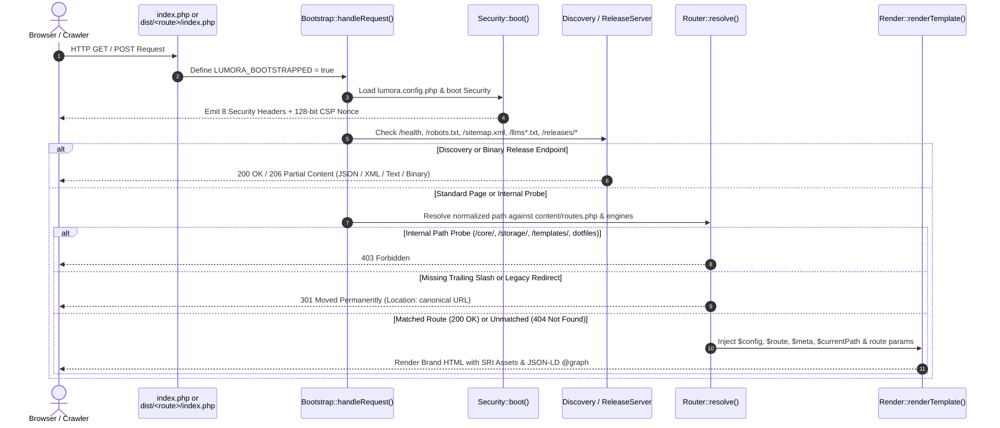
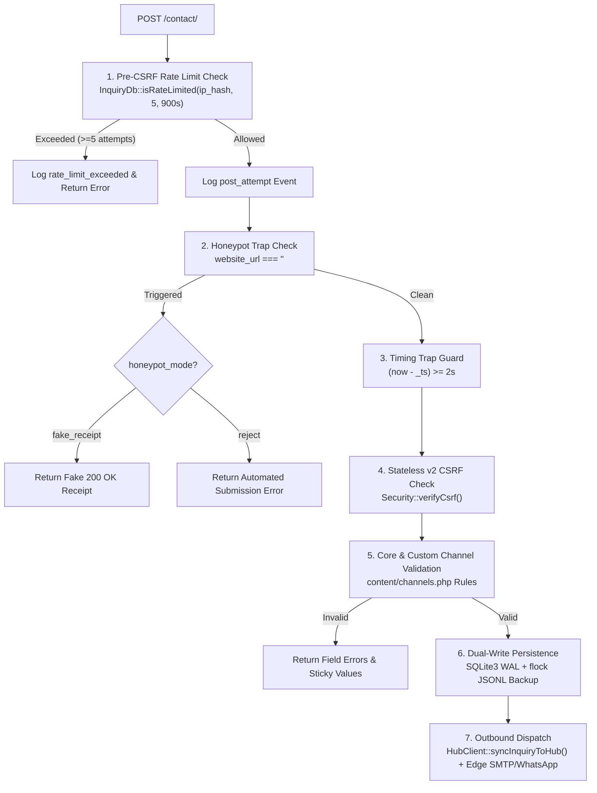

# System Architecture — `@astrake/lumora-webserver`

This document details the internal architecture of `@astrake/lumora-webserver`, covering the PHP 8.2+ request lifecycle, transport security & stateless v2 CSRF, the declarative inquiry engine & SQLite3 WAL vault, the Tailwind CSS v4 compilation pipeline, and the zero-rewrite `dist/` bundler.

---

## 1. End-to-End Request Lifecycle



### Physical Zero-Rewrite Route Stubs (`dist/<route>/index.php`)
On shared hosting environments (cPanel, aaPanel, or static-first PHP hosts) where `.htaccess` or Nginx `try_files` rules may not be active, `lumora-web build` generates a physical `index.php` stub inside every canonical route and redirect directory:
```php
<?php
declare(strict_types=1);
/**
 * @astrake/lumora-webserver — Generated Zero-Rewrite Route Stub (/contact/)
 */
$GLOBALS['lumoraForcedRoute'] = "/contact/";
require __DIR__ . '/../index.php';
```
When `Bootstrap::handleRequest()` detects `$GLOBALS['lumoraForcedRoute']`, it routes the request identically to a front-controller rewrite while computing `$basePath` relative to the website root (`Router::basePath()`).

---

## 2. Security Architecture (`core/security.php`)

### 2.1. Mandatory 8-Header Suite
Every response emitted by `Security::emitSecurityHeaders()` includes:
1. `Content-Security-Policy`:
   - `default-src 'self'`
   - `script-src 'self' 'nonce-<128-bit-base64>'`
   - `style-src 'self' 'unsafe-inline'` (configurable via `security.csp_style_unsafe_inline`)
   - `img-src 'self' data:`
   - `font-src 'self'`
   - `connect-src 'self'`
   - `media-src 'none'` (or `'self'` when `security.csp_media_self` is `true`)
   - `object-src 'none'; child-src 'none'; frame-src 'none'; frame-ancestors 'none'; base-uri 'self'; form-action 'self'`
   - `upgrade-insecure-requests` (on non-localhost environments)
2. `Strict-Transport-Security: max-age=63072000; includeSubDomains; preload`
3. `X-Content-Type-Options: nosniff`
4. `X-Frame-Options: DENY`
5. `Referrer-Policy: strict-origin-when-cross-origin`
6. `Cross-Origin-Opener-Policy: same-origin`
7. `Cross-Origin-Resource-Policy: same-origin`
8. `Permissions-Policy`: Disables `camera`, `microphone`, `geolocation`, `payment`, `usb`, `browsing-topics`, and 20+ browser device APIs (`fullscreen=(self)`).

### 2.2. CGNAT-Resilient Stateless v2 HMAC-SHA256 CSRF
Mobile networks in India and emerging markets frequently use Carrier-Grade NAT (CGNAT), rotating a visitor's public IPv4 address mid-session. Binding CSRF tokens to `REMOTE_ADDR` causes false rejections for legitimate mobile users.

`Security::csrfToken()` and `Security::verifyCsrf()` implement a stateless, zero-cookie v2 token:
- **Token Format:** `{tsHex}.{nonceHex}.{mac}`
  - `tsHex`: Unix timestamp in hexadecimal.
  - `nonceHex`: 128-bit CSPRNG random nonce (`bin2hex(random_bytes(16))`).
  - `mac`: `hash_hmac('sha256', "csrf_lumora_v2|{$brandId}|{$tsHex}|{$nonceHex}|{$uaHash}", $secretKey)` where `$uaHash` is the first 16 hex chars of ` SHA-256(HTTP_USER_AGENT)`.
- **Verification:** Validates hex formatting, checks token age (`-60 <= age <= csrf_ttl_sec`, default `7200s`), recomputes the expected HMAC using `hash_equals()`, and never requires `Set-Cookie` or server-side session files.

### 2.3. Isolated Storage Vault (`storage/vault-<hmac>/`)
- `Security::secretKey()` loads `LUMORA_CSRF_SECRET` from the environment or auto-generates a 256-bit secret in `storage/csrf-secret.php` (`chmod 0600`, guarded by `LUMORA_BOOTSTRAPPED`).
- `Security::vaultDir()` derives a deterministic 128-bit vault folder name (`storage/vault-<32hex>/`) via `HMAC-SHA256('lumora-storage-vault-v1', $secretKey)` and writes `index.php` (`403 Forbidden`) and `.htaccess` (`Require all denied`) guards.

---

## 3. Declarative Inquiry Engine & Dual-Mode Dispatch



### Configurable Data Lifecycle Pruning (`InquiryDb::prune()`)
On every write to `lumora.sqlite`, `InquiryDb::prune()` executes non-blocking retention maintenance according to `lumora.config.php`:
1. **PII Redaction (`legal.retention_days_pii`, default `90`, `0` disables):** Redacts `full_name` (`[REDACTED]`), `organization`, `email` (`redacted@lumora.invalid`), `phone`, `subject`, `message` (`[REDACTED AFTER CONFIGURED RETENTION WINDOW]`), `facility_location`, `details_json`, and `user_agent` while preserving `receipt_id`, `channel`, and `ip_hash`. Setting `0` or `null` disables automated PII redaction and preserves `contact_submissions` rows.
2. **Log Purge (`legal.retention_days_logs`, default `180`, `0` disables):** Permanently deletes `contact_rate_limits` entries (and expired `contact_submissions` rows when PII redaction is active) older than the configured window.

---

## 4. Deterministic CSS & SRI Cache-Busting Pipeline

1. **Input Layers:**
   - `packages/core/runtime/css/lumora-base.css`: Imports Tailwind CSS v4 (`@import "tailwindcss";`), defines default `@theme` structural tokens (`--site-max-width`, `--header-height`, `--font-sans`, `--font-display`, `--font-mono`), `:focus-visible`, `.lumora-skip-link`, `.lumora-honeypot`, and `@media (prefers-reduced-motion: reduce)`.
   - `<website>/css/brand-theme.css`: Defines brand-specific `@theme` design tokens.
   - `<website>/css/brand.css`: Defines brand-specific component and utility rules.
2. **Compilation (`lumora-web css`):**
   - `compileBrandCss()` merges the three layers, compiles and minifies them via `@tailwindcss/cli` v4 into `public/assets/css/lumora.min.css`, and invokes `syncWebsite()` to update the SHA-384 SRI hash in `lumora-lock.json`.
3. **Immutable Cache-Busting (`Render::assetUrl()`):**
   - `.htaccess` and `nginx.lumora.conf` serve `.css` and `.js` files with `Cache-Control: public, max-age=31536000, immutable`.
   - `Render::assetUrl()` automatically appends `?v=<8-char-sha256-of-sri>` to `.css` and `.js` URLs so returning browsers immediately fetch updated assets whenever their SRI hash changes in `lumora-lock.json`.
